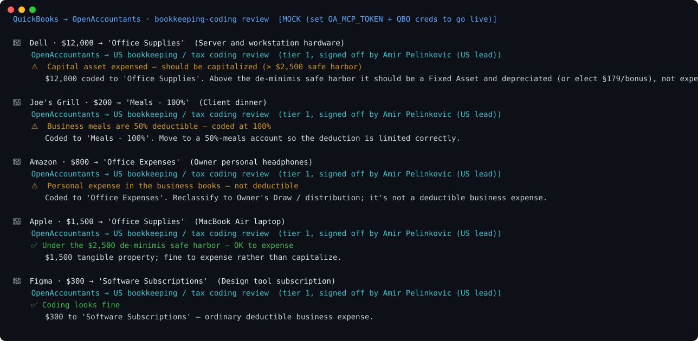

# QuickBooks → OpenAccountants: bookkeeping-coding review

Demonstrates tax-coding checks on QuickBooks-shaped transactions using OpenAccountants sample rules, with an optional live MCP connection.

Default runs use bundled sample responses. Their rates, verdicts and reviewer labels are illustrative fixtures, not evidence that an accountant reviewed the demo or a live Guide. For live use, check the fetched Guide's review status, reviewer, version and review date against the [review method](https://www.openaccountants.com/review-method). A jurisdiction lead's name alone does not establish review. Have a qualified professional review outputs before filing or acting on them.

```
QuickBooks transactions
  └─ { vendor, amount, account, description }
        └─ OpenAccountants MCP  →  load the bookkeeping/tax-coding skill
              └─ Verdict:  ⚠️ capital asset expensed — should be capitalized   ← the catch
                           ⚠️ meals coded at 100% (they're 50%)
                           ⚠️ owner's personal expense in the business books
                           ✅ under the de-minimis safe harbor / ordinary expense
                 · the rule that decided it (cited)
                 · the Guide's published review status, if present
```



> Regenerate the visual: `python make_svg.py` (static SVG, no deps) · animated GIF: `brew install vhs && vhs demo.tape`

## Why this one

QuickBooks records *where* money went; it doesn't know whether the **tax coding** is right. The errors are quiet and expensive:

- a **$12k server expensed** to Office Supplies should be a Fixed Asset, depreciated (or §179) — not deducted in full;
- **business meals** coded at 100% are only 50% deductible;
- an **owner's personal** purchase in the business books isn't deductible at all.

OpenAccountants is the review layer on top of the ledger; using the loaded rules, whose review status must be checked, and it works on the QuickBooks data your customers already have (free developer sandbox, no approval).

## What it shows

A handful of transactions run through the OpenAccountants MCP:

| Transaction | Verdict |
|---|---|
| **$12,000 server → Office Supplies** | ⚠️ **Capital asset expensed — capitalize & depreciate** |
| $200 client dinner → Meals - 100% | ⚠️ Meals are 50% deductible |
| $800 owner's headphones → Office Expenses | ⚠️ Personal — reclassify to Owner's Draw |
| $1,500 laptop → Office Supplies | ✅ Under the $2,500 safe harbor — OK to expense |
| $300 software subscription | ✅ Ordinary deductible expense |

**The money shot:** the $12,000 hardware expensed in full. Above the **$2,500 de-minimis safe harbor** it must be capitalized as a Fixed Asset and depreciated — expensing it overstates the deduction and misstates the books. A bookkeeper miscodes it; OpenAccountants catches it.

## Run it

```bash
git clone https://github.com/openaccountants/quickbooks-tax-demo
cd quickbooks-tax-demo
python pipeline.py                       # bundled sample (mock mode, no keys)
python pipeline.py samples/transactions.json
```

### Go live

```bash
export OA_MCP_TOKEN=...        # OpenAccountants account token (uses live Guide content; check review status)
export QBO_ACCESS_TOKEN=...    # QuickBooks Online sandbox token (free, no approval)
export QBO_REALM_ID=...
python pipeline.py
```

## Files

| File | Role |
|------|------|
| `pipeline.py` | Orchestrator + CLI: QBO → OA → verdict report |
| `qbo_client.py` | QuickBooks transaction extraction (live API or bundled sample) |
| `oa_client.py` | OpenAccountants MCP JSON-RPC client (live or mock) |
| `coding_check.py` | Reviews each transaction's tax coding → verdict |
| `samples/transactions.json` | QuickBooks-shaped transactions |

## Honest notes

- `coding_check.py` is a **coding-review signal** (de-minimis capitalization, meals 50%, personal expenses); not a full chart-of-accounts audit or a depreciation schedule. Production leans on the full OA skill + an agent step; professional review must be established for the specific Guide version and your facts.
- Rules (the $2,500 de-minimis safe harbor, 50% meals) are US figures; the bundled reviewer label is illustrative. Inspect the actual `get_skill` response and its review record in live mode.
